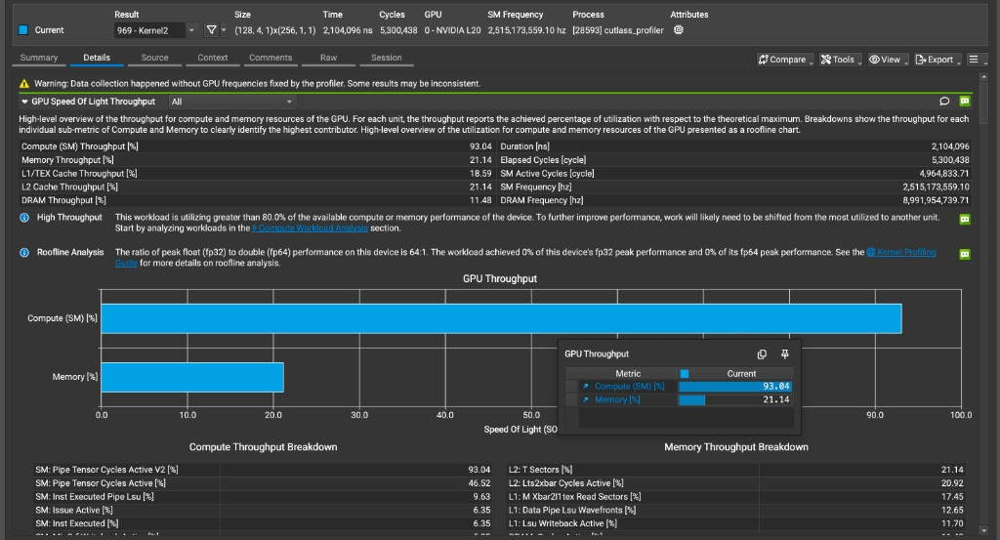
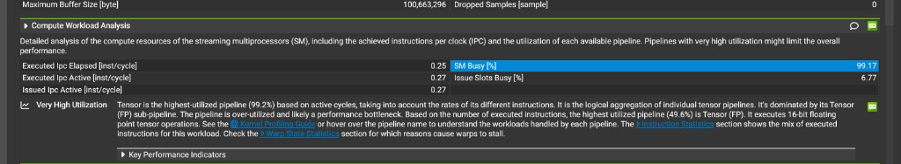

# Nsight Compute 计算利用率指标解读：Compute Throughput、SM Busy 与昇腾指标对标

> 分析对象：CUTLASS GEMM kernel（`cutlass_profiler`，969 - Kernel2），NVIDIA L20，Grid (128,4,1) × Block (256,1,1)

## 结论速览

- 这个 kernel 是 **计算瓶颈（compute bound）**，瓶颈在 **Tensor Core 流水线**：Compute (SM) Throughput 93.04%，Memory Throughput 只有 21.14%。
- 只要 SM 在工作，Tensor 流水线几乎是满的（**SM Busy 99.17%**）。剩下约 6% 的差距来自 **SM 空闲时间**（SM Active ÷ Elapsed ≈ 93.7%），主要原因是尾波效应。
- 三个指标之间的关系（单位均为百分比）：

```math
\underbrace{93.04}_{\text{Compute Throughput}} \approx \underbrace{93.7}_{\text{SM Active / Elapsed}} \times \underbrace{99.17}_{\text{SM Busy}}
```

- 昇腾侧对标：`cube_utilization` ↔ SM Active ÷ Elapsed；`aic_mac_ratio` ↔ SM Busy（严格来说对标的是 Tensor 流水线利用率，见第 3 节）。

---

## 1. Compute (SM) Throughput



### 1.1 计算方式

Compute (SM) Throughput 不是 SM 各单元的平均利用率。NCU 会计算 SM 内部一组子指标（各条执行流水线的利用率、指令发射率、执行指令数等），取其中的**最大值**。所以它表示的是 SM 里**最忙的那个单元**有多忙，也就是瓶颈单元的利用率。

每个子指标都是"实际值 ÷ 理论峰值"，分母按 **Elapsed Cycles**（kernel 从开始到结束的总周期）计算。

### 1.2 Compute Throughput Breakdown

| 子指标 | 值 | 含义 |
|---|---|---|
| SM: Pipe Tensor Cycles Active V2 | **93.04** | Tensor Core 流水线处于忙碌状态的周期占比，Compute Throughput 取的就是这一项 |
| SM: Pipe Tensor Cycles Active | 46.52 | 旧版统计口径，见下面说明 |
| SM: Inst Executed Pipe Lsu | 9.63 | Load/Store 流水线（共享内存、全局内存访问、ldmatrix 等）的利用率 |
| SM: Issue Active | 6.35 | warp 调度器在多少比例的周期里发射了指令 |
| SM: Inst Executed | 6.35 | 实际执行的指令数（IPC）相对峰值的比例 |

### 1.3 容易误解的地方

- **V2 和非 V2 刚好差 2 倍。** 两者是对同一条 Tensor 流水线的不同统计口径。旧版按"执行的指令数 × 名义吞吐率"计算；V2 按流水线实际被占用的周期计算，会考虑当前架构下具体 MMA 指令的精度和形状。这个 kernel 用的 16-bit MMA 指令在 L20 上每条实际占用的周期是名义值的 2 倍，所以旧版口径低估了一半。应当以 V2 的 **93%** 为准。
- **Issue Active 只有 6% 并不代表 SM 闲着。** 一条 HMMA 指令会占用 Tensor 流水线很多个周期，所以 GEMM kernel 本来就是"发射的指令少，但每条指令很重"。这不是延迟（latency）瓶颈。
- **Roofline 显示 FP32 达到峰值的 0% 是正常的。** Tensor Core 运算不计入 FP32/FP64 roofline，这一行对这个 kernel 没有参考意义。

### 1.4 关于 "GPU frequencies not fixed" 警告

这次 profiling 没有锁定 GPU 频率（SM 实际跑在约 2.5 GHz 的 boost 频率上）。百分比类指标是按周期算的，影响不大；但 Duration（耗时）在不同次运行之间可能有波动，做对比时要注意。

---

## 2. SM Busy 与 SM Active Cycles ÷ Elapsed Cycles



一句话区分：**SM Active ÷ Elapsed 衡量 SM 有多少时间在干活；SM Busy 衡量干活的时候最忙的流水线有多满。**

### 2.1 SM Active Cycles ÷ Elapsed Cycles：时间维度的利用率

- **Elapsed Cycles**：kernel 从开始到结束经过的总周期数。
- **SM Active Cycles**：SM 上**至少有一个 warp 驻留**的周期数，对所有 SM 取平均。

本例：4,964,833 ÷ 5,300,438 ≈ **93.7%**。

这个比例**不关心活干得多饱满**：哪怕 SM 上只有一个 warp 卡在等访存，这个周期也算 active。少掉的约 6.3% 是 SM 上一个 warp 都没有的时间，常见原因：

- **尾波（wave quantization / tail effect）**：512 个 CTA 分到 92 个 SM 上，最后一波分配不满，提前做完的 SM 只能空等。
- CTA 启动和退出的间隙。
- 负载不均：有的 SM 分到的 CTA 更多。

### 2.2 SM Busy：干活时流水线的饱满程度

SM Busy 对应 `sm__instruction_throughput.avg.pct_of_peak_sustained_active`，要点有两个：

- **分母是 Active Cycles**，不是 Elapsed Cycles，SM 空闲的时间不计入。
- **取各条流水线利用率的最大值**（Tensor、FMA、ALU、LSU 等）。

本例 99.17% 的意思是：只要 SM 上有 warp 在跑，**Tensor 流水线几乎每个周期都被占满**。截图里的说明文字 "Tensor is the highest-utilized pipeline (99.2%) based on active cycles" 讲的就是这个。

### 2.3 按 Elapsed 算和按 Active 算的指标对照

截图里的指标都能用同一个比例 0.937 对上：

| 按 Elapsed 算 | 按 Active 算 | 比值 |
|---|---|---|
| Compute Throughput 93.04% | SM Busy 99.17% | ≈0.937 |
| Executed IPC Elapsed 0.25 | Executed IPC Active 0.27 | ≈0.937 |
| Pipe Tensor Cycles Active 46.52% | Tensor (FP) 49.6%（按指令数算） | ≈0.937 |

另外两点：

- **Issue Slots Busy 6.77% 也是按 Active 算的。** 每个 SM 有 4 个 warp 调度器，每周期最多发射 4 条指令，所以 0.27 ÷ 4 ≈ 6.75%。它和 SM Busy 不矛盾：指令发得少，但每条 HMMA 指令占用流水线很多个周期。
- **说明文字里出现了 99.2% 和 49.6% 两个 Tensor 利用率。** 49.6% 按"执行的指令数 × 名义吞吐率"计算，99.2% 按流水线实际被占用的周期计算，差 2 倍的原因和 1.3 节中 V2 与旧版指标的差别相同。应当以 99.2% 为准。

---

## 3. 与昇腾（Ascend）指标对标

昇腾侧的 `cube_utilization` 定义为：

```math
\text{cube\_utilization} = \frac{\text{aic\_total\_cycles}}{\text{aic\_frequency} \times \text{ai\_core\_num} \times \text{Task Duration}}
```

### 3.1 cube_utilization ↔ SM Active Cycles ÷ Elapsed Cycles（完全对应）

两者都是**时间维度**的利用率，衡量核在多少比例的墙上时间里有活干：

- 分子 `aic_total_cycles`：所有 AI Core 实际活跃的周期总和，对应 NCU 的 **SM Active Cycles**。NCU 对 SM 取平均，这里是求和，分母里的 `ai_core_num` 把这个差异抵消了。
- 分母 `aic_frequency × ai_core_num × Duration`：所有核的理论可用总周期，对应 NCU 的 **Elapsed Cycles × SM 数**。

它同样不关心活干得饱不饱，少掉的部分是核空闲的时间（尾波、启动/退出间隙、负载不均）。

### 3.2 aic_mac_ratio ↔ SM Busy（方向对，但范围更窄）

`aic_mac_ratio` 的分母是 `aic_total_cycles`（核**活跃**的周期），衡量核在干活时 Cube/MAC 单元被占满的程度，这和 SM Busy 的定义一致。但统计范围不同：

| 指标 | 统计范围 |
|---|---|
| SM Busy | 所有流水线（Tensor、FMA、ALU、LSU 等）利用率的**最大值** |
| aic_mac_ratio | **只统计 Cube/MAC 这一条流水线** |

昇腾侧还有 `aic_vec_ratio`、`aic_scalar_ratio`、`aic_mte2_ratio`/`aic_mte3_ratio`（数据搬运）等并列指标。严格对标 SM Busy 的应当是**这些 ratio 中的最大值**；`aic_mac_ratio` 单独对标的是 NCU 里按 active 归一化的 **Tensor 流水线利用率**。

只有当 Cube 是瓶颈流水线时（类比本例 Tensor 主导），`aic_mac_ratio ≈ SM Busy`。如果瓶颈是向量单元或搬运单元，SM Busy 由那条流水线决定，`aic_mac_ratio` 会偏低，这时不能直接划等号。

### 3.3 两者相乘对应 Compute Throughput

```math
\underbrace{\text{cube\_utilization}}_{\text{核有多少时间在干活}} \times \underbrace{\text{aic\_mac\_ratio}}_{\text{干活时 Cube 有多满}} \approx \underbrace{\text{Cube 忙碌时间占总时间的比例}}_{\text{对标 Compute (SM) Throughput}}
```

### 3.4 指标对照总表

| 含义 | NVIDIA（Nsight Compute） | 昇腾 |
|---|---|---|
| 核有多少时间在干活（时间维度） | SM Active Cycles ÷ Elapsed Cycles | cube_utilization |
| 干活时最忙流水线的饱满程度 | SM Busy | max(aic_mac_ratio, aic_vec_ratio, aic_scalar_ratio, aic_mte*_ratio, ...) |
| 干活时矩阵单元的饱满程度 | Tensor 流水线利用率（按 Active 归一化） | aic_mac_ratio |
| 矩阵单元忙碌时间占总时间的比例 | Pipe Tensor Cycles Active V2（按 Elapsed 归一化） | cube_utilization × aic_mac_ratio |

---

## 4. 优化方向

- **SM Busy ≈ 99%**（昇腾侧对应 `aic_mac_ratio` 很高）：干活时矩阵单元已经跑满，指令层面没有优化空间了。
- **Active 比例 93.7%**（昇腾侧对应 `cube_utilization`）：剩下约 6% 的提升空间全部在核空闲时间上，应处理尾波和负载均衡：
  - 调整 tile 大小，让 CTA 数和 SM 数更匹配；
  - 改用 stream-K、split-K 或 persistent kernel。
- 进一步提升峰值算力的方向：
  - **降低精度**：Ada 架构支持 FP8 Tensor Core，峰值约为 FP16 的 2 倍；
  - **2:4 结构化稀疏**：理论上再获得约 2 倍峰值；
  - **算子融合**：把 GEMM 前后的操作融合进来，减少 kernel 数量和额外开销。

---

# vLLM V1 昇腾 NPU 性能采集总结：多进程模型与 Profiler 落点

## 1. 为什么直接 `msprof python basic.py` 采不到 kernel？

CANN 的 `msprof`只会挂载在它直接 `exec` 拉起的那个 PID 上，**不会自动跟踪** `fork` **/** `spawn` **出来的子进程**（子进程会重新初始化独立的 NPU context，父进程的 profiling 会话不会继承过去）。

因此能否采到 kernel，完全取决于 **真正调用** `model_runner.execute_model()` **向 NPU 下发算子的代码跑在哪个进程**：

| 场景 | 进程拓扑 | 谁下发 NPU kernel | 外层包 `msprof` 能否采到 |
|---|---|---|---|
| `VLLM_ENABLE_V1_MULTIPROCESSING=0` 且 `TP=1` | 单进程（`InprocClient` + `UniProcExecutor`） | 主进程 `python basic.py` | **能** |
| 默认多进程（`=1`），`TP=1`（如 `basic.py`） | 2 层：`SyncMPClient`（主进程）→ `EngineCoreProc`（子进程，`UniProcExecutor`） | 第 2 层 `EngineCore` 子进程 | **不能**（主进程只做 ZMQ 收发，无 NPU 调用） |
| 默认多进程（`=1`），`DP=8, TP=2`（如 `basic_ds.py`） | 3 层：`SyncMPClient` → `DPEngineCoreProc` → `WorkerProc`（`MultiprocExecutor`） | 第 3 层 `Worker_DP*_TP*` 子进程 | **不能**（连第 2 层 `EngineCore` 都只是发 RPC，不跑算子） |

### 结论

- **单卡/单进程可跑的场景**：最简单的方式是加 `VLLM_ENABLE_V1_MULTIPROCESSING=0`，把 Client、EngineCore、Worker 全部合回主进程：
  ```bash
  VLLM_ENABLE_V1_MULTIPROCESSING=0 msprof --output=./prof_temp --msproftx=on \
         --ascendcl=on --runtime-api=on --task-time=on --ai-core=on \
         python basic.py
  ```
- **多卡/多进程必须开启的场景**（如 `DP=8 × TP=2` 的 `MultiprocExecutor`）：不能在主进程或 `EngineCore` 进程起 profiler，必须把 `torch_npu.profiler` 和 `mstx` 打点放到第 3 层 `Worker.execute_model()` **/** `Worker.sample_tokens()` 内部。

---

## 2. 在 `Worker` 进程内嵌 `torch_npu.profiler` 的要点

代码位置：`vllm-ascend/vllm_ascend/worker/worker.py` 的 `execute_model()` 与 `sample_tokens()`。

### 2.1 埋点位置与边界条件

1. **只让 0 号卡采集和打印**：

   多卡场景下（例如 `DP=8, TP=2` 共 16 个 `WorkerProc`），通过 `self.rank == 0 and self.vllm_config.parallel_config.data_parallel_rank == 0` 限制只在 `Worker_DP0_TP0_EP0` 开启 profiler，避免 16 个进程同时写同一个目录。
2. **过滤空转 step**：

   `DPEngineCoreProc.run_busy_loop` 在无请求或等待其他 DP rank 时会空转；而在 `Worker.execute_model` 中配合 `forward_pass = scheduler_output.total_num_scheduled_tokens > 0` 过滤后，`step` 严格对应真实的模型前向步（prefill + decode）。
3. **包含** `sample_tokens` **阶段**：

   vLLM V1 的 `model_runner.execute_model()` 正常返回 `None`，随后 `EngineCore` 会紧接着调用 `worker.sample_tokens()` 执行采样 kernel。因此：
   - 在 `execute_model()` 前向开始前记录 `t1`、`mstx.range_start(f"step_{step}")`、并在目标起点 step 调用 `self._npu_prof.start()`；
   - 若 `execute_model()` 返回 `None`，延后到 `sample_tokens()` 的 `finally` 中再做 `torch.npu.synchronize()`、`mstx.range_end()` 和 `self._npu_prof.stop()`，保证单步 forward + sample 的所有算子都在同一个 `step_N` 区间内。

### 2.2 解决 `daemon` 进程无法在线解析 profiling 数据的问题

- **报错现象**：
  ```text
  [ERROR] profiler.py: The profiling data cannot be parsed during the daemon process, it is recommended that you use an offline parsing interface to parse the collected data.
  ```
- **原因**：
`MultiprocExecutor` 启动 `WorkerProc` 时设置了 `daemon=True`（`multiproc_executor.py:695`）。而 `tensorboard_trace_handler` 在 `stop()` 时会调用 `NpuProfiler.analyse()`，内部需要 fork 一个 `MultiProcessPool` 子进程池去把原始 `PROF_*` 数据解析为 `trace_view.json` 和 `kernel_details.csv`。Python 的 `multiprocessing` 禁止 `daemon=True` 的进程创建子进程，因此 `torch_npu` 检测到 `multiprocessing.current_process().daemon` 为 `True` 时会直接跳过解析。
- **修复方式**：
在调用 `self._npu_prof.stop()` 前临时将当前进程的 `daemon` 标记置为 `False`，同步解析完成后在 `finally` 中恢复原值（子进程内修改 `proc.daemon` 只影响本进程能否拉起孙进程，不影响父进程 `EngineCore` 对 `WorkerProc` 的生命周期管理）：
  ```python
  import multiprocessing as mp

  proc = mp.current_process()
  was_daemon = proc.daemon
  proc.daemon = False
  try:
      self._npu_prof.stop()
  finally:
      proc.daemon = was_daemon
      self._npu_prof = None
  ```

  *(注：若因其他原因未触发在线解析，也可对已落盘的目录手动跑离线解析：*`python -c 'from torch_npu.profiler.profiler import analyse; analyse("./prof_out")'`*)*

---

## 3. 常用采集命令与环境变量速查

`vllm_ascend/worker/worker.py` 中的采集开关与范围已统一由环境变量控制：

| 环境变量 | 默认值 | 说明 |
|---|---|---|
| `VLLM_NPU_PROF` | `"0"` | 设为 `"1"` 开启 `Worker_DP0_TP0` 的 `torch_npu.profiler` 采集 |
| `VLLM_NPU_PROF_START_STEP` | `"20"` | 开始采集并打 `mstx` 标记的起始 step（含） |
| `VLLM_NPU_PROF_END_STEP` | `START_STEP + 2` | 结束采集并触发 `stop()` 解析的终止 step（含） |
| `VLLM_NPU_PROF_DIR` | `"./prof_out"` | `tensorboard_trace_handler` 输出目录 |

### 示例

```bash
# 多进程 / DP+TP+EP 场景采集指定 step 范围（如 step 9~11）
VLLM_NPU_PROF=1 \
VLLM_NPU_PROF_START_STEP=9 \
VLLM_NPU_PROF_END_STEP=11 \
VLLM_NPU_PROF_DIR=./prof_temp \
python basic.py

# 默认 --replay-mode=kernel 会在模型占满 HBM 后再单独重放 kernel，
# driver 侧再申请 20MB PMU buffer 会 OOM，于是没有 DeviceProf*.bin。
# range 在 step_9 这段 mstx 里对原 launch 采样，不必单独重放。
VLLM_NPU_PROF_START_STEP=9 \
VLLM_NPU_PROF_END_STEP=11 \
msprof op \
  --application="python basic.py" \
  --mstx=on --mstx-include=step_9 \
  --kernel-name=MatMulV3_ND_ND_ND_ND_BF16_BF16_BF16_BF16_high_performance_65536 \
  --launch-count=6 --warm-up=0 \
  --aic-metrics=PipeUtilization,Memory,MemoryL0,L2Cache,Roofline \
  --output=./prof_op_step9
```

---

# GPU 与 NPU 的架构差异：写回重叠与算子融合

> 本章讨论两个相关问题：为什么 NPU 上"上一块写回"和"下一块计算"默认不重叠，以及在 Cube 与 Vector 只能通过 GM 交互的前提下，NPU 做算子融合到底收益在哪里。
> 代码与文档引用均指向 [cann/catlass](https://gitcode.com/cann/catlass)（Atlas A2）。

## 1. 结论速览

| 问题 | 结论 |
|---|---|
| NPU 上 Fixpipe 写回能否与下一块 Mmad 重叠 | **能**，但不是默认行为。Fixpipe 是独立流水，瓶颈在 L0C 这块独占 buffer 和显式同步，需要软件用 L0C 双缓冲或 unit flag 显式安排 |
| GPU 为什么"自动"重叠 | 累加器在寄存器、store 异步、SM 硬件多线程切换，三者共同作用，无需程序员干预 |
| NPU 融合能否省掉 Cube↔Vector 之间的 HBM 读写 | **不能**。AIC 与 AIV 无共享片上 buffer，这一跳必须过 GM。只有 Fixpipe 能随路做掉的 epilogue（cast / 反量化 / ReLU / NZ→ND）才真正省掉一次读写 |
| 那 NPU 融合的收益在哪 | 不物化大中间张量、让这一跳命中 L2、Cube 与 Vector 互相掩盖、L1 常驻复用输入、减少 kernel 启动开销 |

---

## 2. 为什么 NPU 的写回与下一块计算默认不重叠

### 2.1 累加器的归属：L0C 是独占的物理 buffer

**NPU（Atlas A2 的 Cube 核）**

- `Mmad` 的累加结果写入 **L0C**（A2 上 128 KB）。
- **Fixpipe** 再把 L0C 的数据搬回 GM，搬运过程中随路完成 NZ→ND 格式转换、类型转换、量化、ReLU。
- 若一个 tile 就占满 L0C（例如 `128×256` 的 fp32 恰好是 128 KB），下一块的 `Mmad` 想写 L0C 就必须等 Fixpipe 把上一块读完——这是 L0C 上的 **写后读冲突（WAR）**。
- 代码层面体现为 FIX 流水与 M 流水之间成对的 `SetFlag` / `WaitFlag`（`HardEvent::FIX_M` 与 `HardEvent::M_FIX`），计算流水只能停下来等。

**GPU**

- 累加器在**寄存器**里。每个 SM 约 256 KB 寄存器堆，分给多个 warp。
- `st.global` 与 TMA store 都是**异步**的：数据进入 LSU 或 TMA 队列后寄存器即可复用，不必等数据真正落到 HBM。

### 2.2 延迟隐藏机制：硬件多线程 vs 单指令流

| | GPU | NPU |
|---|---|---|
| 并发模型 | SIMT，一个 SM 上驻留多个 CTA / warp，各有独立寄存器 | 单条标量指令流，一个 AI Core 同时只跑一个 block，无硬件线程切换 |
| 重叠来源 | warp 调度器在 CTA-A 写回时直接切到 CTA-B 做 MMA，硬件免费完成 | 指令分发到 MTE2 / MTE1 / M / FIX 等流水队列，流水之间可并行，但依赖关系靠程序员或编译器显式插 flag |
| 典型手法 | Hopper 的 warp-specialized + ping-pong：两个 consumer warpgroup 交替跑 epilogue 与 mainloop | L0C 双缓冲、unit flag、preload |

### 2.3 写回路径本身的差异

- GPU 的 epilogue 就是普通 store 指令。
- NPU 的 Fixpipe 是专用流水（`PIPE_FIX`），带随路格式转换；且 A2 上 Cube 的结果只能走 **L0C → GM（或 L1）**，不能直接交给 Vector。Fixpipe 执行期间 L0C 对应区域一直被占用。

### 2.4 让 NPU 也重叠起来

Fixpipe 本身是独立流水，硬件上可与 `Mmad` 并行，瓶颈只是 L0C 资源与同步粒度。catlass 的 dispatch policy 提供了对应开关：

```cpp
// include/catlass/gemm/dispatch_policy.hpp
template <uint32_t PRELOAD_STAGES_, uint32_t L1_STAGES_, uint32_t L0A_STAGES_, uint32_t L0B_STAGES_,
    uint32_t L0C_STAGES_, bool ENABLE_UNIT_FLAG_, bool ENABLE_SHUFFLE_K_>
struct MmadAtlasA2PreloadAsync : public MmadAtlasA2Async {
    static constexpr uint32_t PRELOAD_STAGES = PRELOAD_STAGES_;  // 提前下发 load 指令的级数
    static constexpr uint32_t L1_STAGES  = L1_STAGES_;
    static constexpr uint32_t L0A_STAGES = L0A_STAGES_;
    static constexpr uint32_t L0B_STAGES = L0B_STAGES_;
    static constexpr uint32_t L0C_STAGES = L0C_STAGES_;
    static constexpr bool ENABLE_UNIT_FLAG  = ENABLE_UNIT_FLAG_;
    static constexpr bool ENABLE_SHUFFLE_K = ENABLE_SHUFFLE_K_;
};
```

| 手段 | 做法 | 代价 |
|---|---|---|
| `L0C_STAGES = 2`（L0C 双缓冲） | 缩小 tile（如 `128×128` fp32 = 64 KB），两份放进 L0C 做 ping-pong；块 `i` 写回时块 `i+1` 的 `Mmad` 写另一半 | tile 变小，L1 / GM 数据复用率下降 |
| `ENABLE_UNIT_FLAG = true` | 让 `Mmad` 与 Fixpipe 在 L0C 上按小单元细粒度握手，不必整块算完再整块搬走，最后一个 k 步可与写回交叠 | **输入为 int8 时必须关闭**（源码注释明确约束） |
| Preload / Async kernel | 提前下发下一块的 load 指令，把 MTE2 与计算、写回错开（见 `basic_matmul_preload` 等样例） | 同步逻辑复杂度上升 |

> 小结：GPU 的重叠来自"硬件多线程 + 寄存器累加器 + 异步 store"；NPU 是单流多流水架构、L0C 又是稀缺共享 buffer，重叠必须软件显式实现，代价记在 tile 尺寸或同步复杂度上。

---

## 3. NPU 算子融合的收益在哪里

### 3.1 前提：Cube 与 Vector 之间那一跳省不掉

Atlas A2 上 AIC（Cube）与 AIV（Vector）是**分离的核，没有共享的片上 buffer**：

```
Cube:   L0C --Fixpipe--> GM
Vector: GM  --MTE2-----> UB --计算--> UB --MTE3--> GM
```

地址空间上这就是 GM。与 GPU 上 Tensor Core 累加器留在寄存器、CUDA Core 直接接着算，**不是一回事**。因此 NPU 的 Cube-Vector 融合**不省这一跳的流量**。

### 3.2 真正省掉 HBM 读写的：Fixpipe 随路 epilogue

能少写一次 HBM 的是 Fixpipe 随路做掉的部分，而非其后的 Vector。catlass 的 `CopyL0CToGm`（`include/catlass/gemm/tile/copy_l0c_to_gm.hpp`）通过 `QuantMode` 支持：

| 随路操作 | QuantMode |
|---|---|
| fp32 → fp16 | `F322F16` |
| fp32 → bf16 | `F322BF16` |
| fp32 / int32 直出 | `NoQuant` |
| int32 → fp16，per-tensor 反量化 | `DEQF16` |
| int32 → fp16，per-channel 反量化 | `VDEQF16` |
| ReLU | 模板参数 `ReluEnable` |
| NZ → ND 格式转换 | Fixpipe 固有能力 |

fp16 输入场景下，`Mmad` 在 L0C 上以 fp32 累加，Fixpipe 搬回 GM 时直接 cast 成 fp16，**fp32 中间结果不会落成一块 GM tensor**。不融合的话路径是「L0C 以 fp32 写出 → 读进 UB → cast / ReLU → 写回」，多一次全尺寸读写，且按 4 字节而非 2 字节计量。

> **对标关系**：GPU 用寄存器 epilogue 省掉的那部分，在 NPU 上只有 Fixpipe 覆盖得了的几项（cast、per-tensor / per-channel 反量化、ReLU、NZ→ND）对得上。**SiLU、残差加、RMSNorm、RoPE 都不在这条路径上**，融进同一个 kernel 仍要写 GM、再读进 UB。

### 3.3 Cube-Vector 融合的五项真实收益

即便流量省不掉，把 Cube 与 Vector 放进同一个 kernel 仍有收益，账记在流量之外：

**① 不物化大中间张量**

FlashAttention 一类融合省的是整块 $S = QK^\top$，而非单个 tile 的那一次读写。每个 tile 仍是 Cube 写 GM、Vector 再读，但 workspace 只有一块 tile，算完即复用；不融合则要把 $O(N^2)$ 的 score 矩阵全部落盘。catlass 的 MLA 样例就是这个结构：QK 的 `BlockMmad` 与 softmax 的 `BlockEpilogue` 在同一 kernel 内按块交替。

**② 走 GM 不等于走 HBM**

Fixpipe 刚写完、对端 Vector 立刻读，数据大概率还在 L2 里。拆成两个 kernel 时，Cube kernel 要把所有 tile 写完，中间还隔着一次 launch，L2 很容易被其他核冲掉，Vector 再读就是实打实的 HBM。融合保住的是这段**时间局部性**。

**③ Cube 与 Vector 互相掩盖**

A2 上一个 Cube 配两个 Vector。分开跑时，matmul kernel 期间 Vector 空闲，softmax kernel 期间 Cube 空闲。MLA 按 `blockSize` 切块、提前下发下一块的 QK `Mmad`，让上一块的 softmax 与之重叠，靠 `CrossCoreSetFlag` 做 tile 粒度同步。kernel 之间只能整网格同步，做不到这种重叠。

> 这一点直接体现在本文第 3 节的 profiling 指标上：融合后 `aic_mac_ratio` 与 `aiv_vec_ratio` 可以同时维持在较高水平；不融合时两者在时间轴上交替塌陷，`cube_utilization` 随之下降。

**④ Cube 侧少搬一次输入**

同一 kernel 内 K 与 V 是同一段数据，K 可常驻 L1 供后续 PV 复用（MLA 通用 kernel 的做法）。这是 L1 复用、与 Vector 无关，拆开就得从 GM 再搬一次。注意这与基块大小存在取舍：MLA 的 TP1 特化 kernel 因基块放大、buffer 不够，反而取消了 K 常驻，换取 PV 阶段更低的搬出带宽。

**⑤ 减少 kernel 启动开销**

小 M（decode）场景下，host 下发与核启动开销往往比那一跳 L2 读写更大。

### 3.4 GPU 与 NPU 融合收益对照

| 收益项 | GPU | NPU |
|---|---|---|
| 省掉矩阵结果到后处理的 HBM 读写 | ✅ 寄存器 epilogue，任意逐元素算子 | ⚠️ 仅限 Fixpipe 随路能做的 cast / 反量化 / ReLU / NZ→ND |
| Cube(Tensor Core) → Vector(CUDA Core) 的数据通路 | 寄存器，零开销 | GM（可能命中 L2），无法消除 |
| 不物化大中间张量 | ✅ | ✅ |
| 矩阵单元与向量单元并行 | ✅ 同一 SM 内 warp 调度自动完成 | ✅ 但需 AIC/AIV 跨核显式同步（`CrossCoreSetFlag`） |
| 输入在片上复用 | ✅ shared memory | ✅ L1 常驻 |
| 减少 kernel 启动 | ✅ | ✅ |

---

## 4. 两个问题的统一视角

两个问题其实是同一件事的两面：**昇腾 AI Core 是"显式流水 + 显式片上存储"的架构，GPU 是"硬件多线程 + 隐式缓存"的架构。**

- GPU 把重叠和数据通路交给硬件（warp 调度器、寄存器堆、L1/L2），程序员写出朴素代码也能拿到不错的重叠。
- NPU 把 L1 / L0A / L0B / L0C / UB 和 MTE2 / MTE1 / M / FIX / V 各条流水都暴露给程序员，重叠与复用必须显式编排——上限更高，但不写就没有。

因此在 NPU 上做性能分析时：

1. 先看 `cube_utilization`（核有多少时间在干活）——低则多半是流水没排开（写回与计算串行、Cube 与 Vector 交替塌陷、尾波）。
2. 再看 `aic_mac_ratio` / `aiv_vec_ratio` / `aic_mte*_ratio` 的最大值（干活时最忙流水有多满）——定位瓶颈流水。
3. 若瓶颈在 FIX 或 MTE3，优先考虑 L0C 双缓冲、unit flag，以及把能随路做的 epilogue 塞进 Fixpipe。

