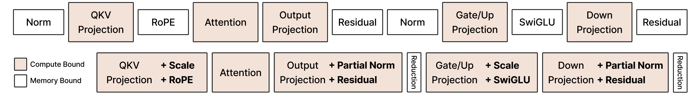

# CODA 重参数化笔记

本文记录 CODA 把 Transformer block 改写成 GEMM-plus-epilogue 程序的核心思路，以及它在 `diff.py` 这个最小复现脚本里的具体落地方式。

<p align="center">
  
</p>

## 1. 问题：memory-bound 算子的往返开销

上排是标准的 Transformer block 分解，深色是 compute bound（GEMM / attention），白色是 memory bound（Norm、RoPE、Residual、SwiGLU）。白块几乎不做浮点计算，但每一个都要把整张 `(M, N)` 激活从 HBM 读出再写回。一个 block 里 GEMM 和纯搬运交替出现，白块的耗时基本全花在带宽上。

## 2. 关键变换：RMSNorm 的三段拆分

难点在 RMSNorm：它要沿整行 `N` 做归约，而一个 GEMM 输出 tile 只持有该行的一小段，无法在 epilogue 里直接算出 `rstd`。

CODA 的做法是利用「per-row 标量缩放与右乘权重矩阵可交换」这一性质：

```
(x * r) @ W == (x @ W) * r        # r 是 per-row 标量
```

于是 RMSNorm 被拆成三段，分别塞进不同位置：

| 阶段 | 放在哪里 | 说明 |
|------|----------|------|
| **Partial Norm** | 前一个 GEMM 的 epilogue | 算本 tile 的部分平方和；norm 权重向量 `w_n` 是逐列的、不需要跨列归约，可以在 tile 内直接乘掉 |
| **Reduction** | 独立小 kernel | 合并各 tile 的部分和 → per-row `rstd`，形状 `(M, num_blocks) -> (M,)` |
| **Scale** | **下一个** GEMM 的 epilogue | 按行广播乘 `rstd`，补上归一化 |

图里下排的 `+ Partial Norm`、窄条 `Reduction`、`+ Scale` 就是这三段。其余算子（Residual、SwiGLU、RoPE）本来就是逐元素的，直接折叠进相邻 GEMM 的 epilogue。

结果是 11 个 kernel 压缩成 6 个：4 个 GEMM + 1 个 attention + 2 个窄 reduction。后者是整条流水线上仅存的 memory-bound kernel。

注意融合单元跨过了层边界：一个单元覆盖「本层 attention 输出投影 → MLP → **下一层** QKV 投影」，因为要让每个 norm 的 partial 阶段和 scale 阶段各自贴住一个 GEMM。对应 `models/ops.py` 的 `layer(x0, y0, w0, w1, w2, w3, wn0, wn1, cos_sin, ...)`。

## 3. 在 `diff.py` 中的落地

`diff.py` 里的 `coda()` 是上图下排中间三个单元的最小切片（不含 RoPE 和下一层 QKV）：

```python
D, S, O = gens.gemm_residual_partial_rmsnorm(A=y, B=w_a, C=x, W=w_n, block_size=block_size)
R       = compute_rstd(s=S, eps=1e-6, use_quack=False)
D, O    = gens.gemm_rmsnorm_swiglu(A=O, B=w_b, R=R)
```

### 第 1 行 — `Output Projection + Partial Norm + Residual`

语义见 `kernels/refs/gpt.py`：

```
D = A @ B + C              # (M, N)          out-proj + residual
S = mean(D**2, per block)  # (M, num_blocks) 部分归约统计，fp32
O = D * W                  # (M, N)          norm 权重缩放
```

在 CuTeDSL 实现里三个输出是同一趟写出的，累加器 tile 还在寄存器时就完成了全部 epilogue 计算。实际跑起来的 epilogue 链（来自 JIT 编译日志）是：

```
matrix.EVTResidual → reduction.EVTColBlockReductionStore → kernels.gens.epilogue.kernel_0.EVTRowVecMulPostAct
```

### 第 2 行 — `Reduction`

`models/ops.py::compute_rstd` 沿 `num_blocks` 合并再取 `rsqrt`。按 `M=N=4096, block_size=128` 计算，它读的是 `4096 x 32` fp32 = **512 KB**；若在此处做常规整行归约则要读 `4096 x 4096` bf16 = **32 MB**，相差 64 倍。这就是保留这个小 kernel 不心疼的原因。

### 第 3 行 — `Gate/Up Projection + Scale + SwiGLU`

输入是 `O`（只乘了 `w_n`、尚未除以 rstd 的「半归一化」张量），`R` 在 GEMM **之后**才乘：

```
D    = A @ B
D    = D * R               # per-row 广播，重参数化在此兑现
G, U = interleaved_split(D)
O    = silu(G) * U         # (M, N // 2)
```

epilogue 链：

```
kernels.gens.epilogue.kernel_1.EVTRMSNormScale → activation.EVTActivationWithDualOutputs
```

因为 mainloop 不依赖 `R`、只有 epilogue 需要它，第 2 行的 reduction 不会阻塞第 3 行 GEMM 的启动。

### 返回值用途

- 第 1 行的 `D`：未归一化的残差流，传给下一层 + 反向使用
- 第 3 行的 `D`：归一化后的 pre-activation，反向算 SwiGLU 梯度要用
- 第 3 行的 `O`：down projection 的输入

## 4. 实测结果

配置：`M = K = N = 4096`，bf16，`block_size = 128`，`gens.USE_TUNED = False`（关闭 autotune），H100。

精度（对比 `kernels/refs` 的 PyTorch 实现）：

```
D: l2_relative_error 8.26e-06, similarity 1.0000000
O: l2_relative_error 1.52e-05, similarity 0.9999999
```

耗时（3 次运行）：

| | coda (ms) | torch_ref (ms) | speedup |
|---|---|---|---|
| run 1 | 2.199 | 2.675 | 1.217 |
| run 2 | 2.235 | 2.679 | 1.199 |
| run 3 | 2.261 | 2.703 | 1.195 |

## 5. 解读这些数字时的注意事项

- **基线是重参数化后的版本，不是朴素版本。** `torch_ref()` 调用的 `refs.*` 与 `coda()` 用的是同一套数学，只是没融合。所以 ~1.2x 衡量的只是「epilogue 融合省下的 HBM 往返」，不包含从上排到下排的算法收益。要量化重参数化本身，需要再加一条朴素基线（GEMM → 完整 RMSNorm → GEMM → SwiGLU 各自独立成 kernel）。
- **autotune 是关掉的。** `USE_TUNED = False` 时 `block_size=128` 是手工给的，开启后数字会更好。
- **首次运行有 JIT 编译开销**，日志里的 "Kernel compilation cache miss" 属正常现象；`time_ms` 已有 warmup，不影响计时。

## 6. 代价

- epilogue 复杂度上升：需要额外的 smem / 寄存器预算，寄存器压力可能反过来限制 GEMM tile 尺寸
- partial reduction 的 `block_size` 需要 autotune
- 反向也要推一套对应的融合形式，见 `models/ops.py` 中的 `layer_*_backward_tunable` 和 `refs.gemm_residual_partial_rmsnorm_bwd`

## 7. 边界：为什么不融合 GEMM → GEMM

CODA 只把 memory-bound 算子融进 compute-bound kernel，四个投影 GEMM 之间始终隔着一次 HBM 往返。仓库里没有任何 back-to-back GEMM 实现（`persistent` 那几处指的是 persistent tile scheduler），这是刻意的。

### 融合会破坏什么

考虑 `Y = (A @ B1) @ B2`。GEMM2 中负责输出 tile `(m, n2)` 的 CTA，其归约维 `K2` 就是 `N1`，所以它需要中间结果 `X[m, :]` 的**整行**。这意味着 **`N1` 必须从 grid 里退出**，从跨 CTA 的并行维降级为 CTA 内部的循环维。grid 从 `(M/BM) x (N1/BN1)` 变成 `(M/BM) x (N2/BN2)`。

代价随即落在三种资源上，且会互相转化：

| 方案 | 代价 | 在 `N1=N2=4096` 时 |
|------|------|--------------------|
| 整行留在片上 | smem 容量 | `(128, 4096)` bf16 = 1 MB（fp32 累加器 2 MB），H100 每 SM 仅 228 KB |
| 流式，逐 `n1` tile 现算现用 | 重复计算，因子 `N2/BN2` | 32 个 CTA 各把 `A @ B1` 重算一遍，FLOPs x32 |
| 不切分 `N2` 以消除重复 | 并行度 + 累加器容量 | 只剩 32 个 CTA（H100 有 132 SM），且累加器回到 2 MB |

CUTLASS B2B GEMM 走的是第一条路，硬性约束是 `ThreadblockShape0::kN` 等于 GEMM1 的完整 N，因此只适用于 `N1` 在 64/128 量级的场景。

### 即便可行也不划算

按 `M=K=N=4096` bf16 估算：一次 GEMM 是 `2 * 4096^3 ≈ 137` GFLOP，H100 上约 200 μs；省下的中间张量往返是 32 MB 写 + 32 MB 读，3 TB/s 下约 20 μs。上限约 10%，却要换来死板的 tile 形状约束。

对比 CODA 实际融掉的 RMSNorm / SwiGLU：各自是数趟 32 MB 往返，且完全没有计算量来摊薄。把 memory-bound 塞进 compute-bound 的 epilogue 几乎是白赚；而 compute-bound 融 compute-bound，两边抢同一个 tensor core，没有可互相隐藏的资源。

### 对照：Flash Attention 为什么能融

FA 的 `S = Q @ K^T` → `O = P @ V` 是货真价实的 GEMM→GEMM 融合。它同样付了「流式重算」的代价，只是重复因子恰好为 1：

| | Flash Attention | MLP / 投影链 |
|---|---|---|
| `N1`（中间结果宽度 = `K2`） | `seq_k` = 4096，同样装不下，同样流式 | 4096，流式 |
| `N2`（最终输出宽度） | `head_dim` = 128，**无需切分** → 重复因子 1 | 4096，必须切分 → 重复因子 32 |
| 不切 `N2` 时的累加器 | `(128, 128)` fp32 = 64 KB，寄存器可容 | `(128, 4096)` fp32 = 2 MB |
| 并行度来源 | `batch x heads x m_tiles`，可达数千 CTA | 仅 `m_tiles`，32 个 |
| 中间结果规模 | `O(s^2)`，是输入输出的 32 倍且随 `s` 恶化 | `O(s*d)`，与输入输出同量级 |

结论是：**能否融合取决于最终输出的宽度 `N2`，而不是中间结果的宽度 `N1`。** FA 同时满足输出窄、并行度另有来源、中间结果超大三个条件，投影链一个都不满足。

另可注意 softmax 的行归约与 RMSNorm 属同一类跨 tile 归约问题，但 FA 的所有 `n1` tile 都在同一个 CTA 内顺序流过，用 online rescaling 即可解决，不存在跨 CTA 通信；CODA 面对的是真正的跨 CTA 归约，所以才需要第 2 节那套三段拆分。

### CODA 的实际做法

不融合 GEMM，但让 GEMM1 的 epilogue 直接产出 GEMM2 想要的格式（`gemm_residual_partial_rmsnorm` 的 `O` 已乘好 `w_n`，可直接喂给下一个 GEMM），中间不需要任何转换 pass；同时把 reduction 解耦成不阻塞 mainloop 的小 kernel。中间张量仍过一次 HBM，但除此之外没有多余搬运。

## 8. 更广的视角：算子融合方案谱系

按「融合为什么划算」归类，CODA 属于其中第二类。

**归约重构 — 中间结果远大于输入输出。** 判据是中间张量规模在渐进意义上超过输入输出，不融合就是错的。Flash Attention 是代表；同族还有 fused linear cross-entropy（logits 是 `(B*T, vocab)`，128k 词表下一个 8k token 的 batch 就是 4 GB，而它只用来归约成标量 loss，分块后峰值显存降到 `O(chunk * V)` —— CODA 的 `linear_cross_entropy` 即属此类）、FlashDecoding / split-KV（解码时 m_tile 不足，切 KV 维补并行度再做二次归约）、Ring Attention（把 tile 循环搬到设备间）、chunked linear attention（块内矩阵形式 + 块间状态递推）。

**Epilogue / Prologue 折叠 — 把 memory-bound 塞进 compute-bound。** CODA 所在的类。基础设施是 CUTLASS EVT（CODA 建于其上）与 cuDNN runtime fusion engine；上层有 TensorRT 的层融合、Inductor 在 max-autotune 下把 pointwise 融进 matmul 模板、以及 Apex / TransformerEngine 的 fused LayerNorm+dropout+residual。

**Prologue 解量化 — 砍掉权重搬运量。** Marlin / Machete 的 W4A16，在 MMA 前于寄存器内把低比特权重解回半精度。详见第 9 节。

**通信-计算融合。** 把 GEMM 按 tile 切开，算完一块发一块，让 NCCL 与 tensor core 真正重叠。代表是 FLUX、PyTorch async-TP（基于 symmetric memory）、Megatron-LM 的 sequence-parallel overlap；MoE 版本是 DeepEP 的 dispatch/combine 流水化。

**Megakernel — 消灭 kernel 边界本身。** 把整个 forward 塞进一个 persistent kernel，消除 launch 开销、尾部效应与层间隐式同步，靠 GPU 端指令队列做细粒度依赖调度。与 CODA 正交：CODA 优化 kernel 内部数据流，megakernel 优化 kernel 之间的调度。

**自动化。** Triton / Inductor / ThunderKittens / Mirage superoptimizer。CODA 自己也在这条线上 —— `kernels/gens/` 标注为 LLM-authored，配合 `rapier/docs/codegen_prompt.md`；约束成固定的 GEMM+epilogue 接口正是为了让自动生成可控。

## 9. 融合位置的一般原则

> **量化尽可能早（生产者的 epilogue），解量化尽可能晚（消费者的 prologue），中间每一次字节搬运都保持压缩态。**

两者不是二选一，而是同一条流水线的两端。KV cache 量化是最清楚的例子：写入时在生产者 epilogue 量化，读取时在 attention 的 prologue 解量化，中间在 HBM 里一直是低比特。

### 为什么权重解量化只能放在 prologue

权重是静态参数，没有任何 kernel 产出它，不存在可融合的「前一个算子」。若提前展开成 FP16 写回 HBM，等于放弃全部收益 —— W4A16 的价值就在于「从 HBM 搬的字节少 4 倍」。压缩态必须一路撑到片上，所以解量化点必须晚到寄存器里、`mma` 的前一刻。

反过来，**激活**由前序算子产出，量化就该融进生产者的 epilogue，这正是 TransformerEngine（amax 统计 + FP8 cast 融进上一个 GEMM 的 epilogue）和 DeepGEMM（per-block scale 由上游顺手算好）的做法，动作上与 CODA 把 RMSNorm 塞进 epilogue 完全同构。

另外，prologue 解量化本质是**硬件格式缺口的补丁**：tensor core 不认识 INT4。Blackwell 原生支持 NVFP4/MXFP4 后，低比特可直连 MMA，scale 退化为 epilogue 里的一次缩放，与 CODA 处理 `rstd` 的方式无异。

### Prologue 解量化的额外开销

| 开销 | 说明 |
|------|------|
| 指令发射 | 解量化跑在 ALU 上，与 MMA 抢发射槽。朴素实现每值 4-6 条指令；实用做法用 `lop3.b32` 把 4-bit 直接拼进 FP16 尾数位构造 `0x6400+v`，再一条 `sub`/`fma` 修正，摊到每 2 值约 2-3 条 |
| 寄存器压力 | 解出的权重、打包原始数据、group scales / zero points 同时占寄存器，occupancy 下降 |
| 离线重排 | 为让解量化后的寄存器布局直接匹配 `mma` fragment（免 shuffle），权重需预先 permute（Marlin format）。后果是格式绑定 kernel、无法跨后端共享，且 (位宽 × group size × 对称性 × 激活 dtype) 每种组合都要单独调优 |
| group 边界 | group-wise scale（常见 group=128）在 K 循环里引入边界逻辑，需重新加载并施加 scale |
| 精度 | W4+group128 有损，依赖 GPTQ/AWQ 校准 |

注意解量化成本会被 `BLOCK_M` 摊薄（权重 tile 解一次供 BM 行复用），但 BM 大时本来就不需要量化 —— 这个矛盾直接决定了适用区间。

### 适用区间

W4A16 的算术强度是 `4M` FLOP/byte。H100 SXM 的 BF16 稠密算力约 990 TFLOPS、HBM3 带宽 3.35 TB/s，ridge point 约 295 FLOP/byte，解得 **`M ≈ 74`**：

- **`M ≲ 64`：用。** 仍在带宽墙下，压缩几倍快几倍，解量化的 ALU 开销被 HBM 等待完全掩盖。Marlin 在 batch ≤ 32 时接近理论 4x。典型工况是单请求解码。
- **`64 ≲ M ≲ 300`：实测。** W4 已进入 compute bound，但 FP16 kernel 的 ridge point 在 `M ≈ 295`，仍有收益但快速衰减。Machete 等 Hopper wgmma + TMA 重写主要改善这一段。
- **`M ≳ 300`：不要用。** 两边都 compute bound，解量化变成纯开销。vLLM 有启发式在大 batch 切回非量化 kernel。

另外三个信号：MoE 天然适合（单专家有效 M 极小，且容量收益最大）；权重需静态以摊掉离线 repack 成本，故**训练不适用**；显存装不下时无条件用，此时收益是可行性而非速度。

**大 batch 想省算力应走另一条路**：权重和激活一起量化到 tensor core 原生格式（FP8），硬件本身快 2 倍，无需解量化 prologue，scale 融进累加器即可。分野是 **W4A16 买带宽，W8A8/FP8 买算力**；前者服务解码，后者服务 prefill 与训练。

### 与第 2 节的呼应

激活量化想融进 epilogue 也有同一个坑：**per-tensor amax 是跨 CTA 归约**，生产者的每个 CTA 只看得到自己的 tile。解法与 CODA 处理 RMSNorm 同构，仍是那两条：

- **delayed scaling**（TE 默认）—— 用上一步的 amax cast 当前步，把依赖推迟到不阻塞的地方，代价是数值滞后
- **per-block / per-tile scaling**（DeepGEMM、NVFP4）—— 把归约域缩小到 tile 内，量化变成纯局部操作，天然可融

一句话：**要么把归约域缩小到 tile 内，要么把依赖推迟到不阻塞的地方。** CODA 的三段拆分同时用了这两招。

## 相关文件

- `figs/reparameterization.png` — 本文配图
- `diff.py` — 最小复现 + 精度/性能对比脚本
- `kernels/gens/gpt.py` / `kernels/refs/gpt.py` — CuTeDSL 实现与 PyTorch 参考
- `kernels/gens/epilogue/kernel_0.py`、`kernel_1.py` — 上述两个 epilogue 链的自定义 visitor
- `rapier/epilogue/` — 可组合的 epilogue visitor 基础设施
- 论文：[arXiv:2605.19269](https://arxiv.org/abs/2605.19269)
